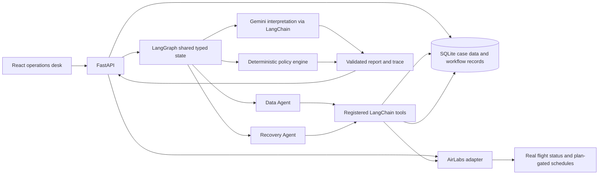

# Flyo Disruption Desk v2

An airline-operations recovery demo that combines **simulated customer/disruption cases** with **AirLabs flight facts**. Real flight status is fetched server-side; upcoming schedule search is available only when the configured AirLabs account plan includes it. A schedule is not seat or fare inventory. Flyo never books, cancels, refunds, or rebooks.

## Architecture



LangGraph makes the sequence, shared state, conditional routing, and terminal outcome explicit. Registered LangChain tools retrieve training records and AirLabs schedules. Python policy code computes connection buffers and schedule fit; Gemini can explain supplied facts but cannot alter the policy result. Reports and traces identify the training-case database separately from AirLabs. Human review is persisted separately from analysis and never represents a booking action.

## Run locally

Requirements: Python 3.11+, Node.js 20+.

```bash
cd backend
python -m venv .venv
source .venv/bin/activate
pip install -r requirements.txt
cp .env.example .env
python -m app.seed
uvicorn app.main:app --reload
```

The database seeds exactly 50 synthetic cases, including the six core scenarios and the `INDEMO0025` regression. Re-running `python -m app.seed` is idempotent and preserves existing runs and human review history. For an intentional full local reset, stop the server, remove only `backend/flyo_disruption.db`, then seed again. The default SQLite path is relative to the backend working directory.

Copy `backend/.env.example` to `backend/.env`. Keep both provider keys server-side:

```env
GEMINI_API_KEY=...
AIRLABS_API_KEY=...
AIRLABS_BASE_URL=https://airlabs.co
```

Flight status is available on its own Flight status page instead of expanding inside every case. In a case, AirLabs alternatives appear below the flight and cancellation details. **Search AirLabs schedules** shows every matching provider result for review. **Run recovery agents** evaluates those same provider facts and returns at most three distinct eligible schedule slots, ranked by earliest departure; the first is marked as the best schedule match. This timing-based shortlist is not seat or fare inventory and is not a booking recommendation. AirLabs' dated Schedules API has a rolling horizon of up to 10 hours; when no dated rows match, Flyo also queries AirLabs' recurring Routes Database for patterns operating on the requested weekday. The dashboard labels route patterns separately because they are not live dated schedules or status updates. The app never substitutes seeded training alternatives for failed provider calls. The account plan and quota are not inferred by Flyo; the provider remains authoritative for authorization and limits.

In a second terminal:

```bash
cd frontend
npm install
npm run dev
```

Open http://localhost:5173. Browse cases and deterministic policy without either API key. To run AI explanations, configure `GEMINI_API_KEY`; the only supported model is `gemini-3.5-flash-lite`. The frontend never receives either key. Tests mock both providers. API and provider errors remain visible and are never replaced with fabricated results.

## Deploy a free online demo

The root `render.yaml` defines a Render Blueprint with a FastAPI web service and a static Vite site. It pins the sole supported Gemini model, wires the frontend API URL from the deployed backend, seeds the 50 demo cases at backend startup, and allows the hosted frontend origin through CORS. To deploy, push this repository to GitHub, connect it to Render, choose **New → Blueprint**, and select this repository. Render builds both services from `main`; its dashboard displays the assigned URLs. The frontend can also be deployed to Vercel separately by setting its root directory to `frontend`, build command to `npm run build`, output directory to `dist`, and `VITE_API_URL` to the backend URL; configure the backend CORS origin for the Vercel domain.

The Blueprint uses Render's Free web-service plan. Free instances can sleep and have no persistent disk, so SQLite workflow runs and review decisions can reset when the service restarts; the seed data is recreated automatically. This is a public demo setup, not a production deployment. Configure `GEMINI_API_KEY` and `AIRLABS_API_KEY` in the backend service's Render environment settings to enable provider-backed features. Do not put either secret in this repository, a frontend setting, or a deployment manifest. Without these settings, case browsing and deterministic policy remain available while AI and AirLabs actions report configuration errors.

## API

OpenAPI/Swagger: http://localhost:8000/docs

- `GET /health`
- `GET /api/cases`, `GET /api/cases/{case_id}`
- `GET /api/cases/{case_id}/itinerary`, `/alternatives` (AirLabs), `/policy`
- `POST /api/cases/{case_id}/analyze` or `/recovery`
- `GET /api/aviation/status`
- `GET /api/aviation/flight-status?flight_number=AI%20101&flight_date=YYYY-MM-DD`
- `GET /api/cases/{case_id}/live-alternatives?flight_date=YYYY-MM-DD` (all matching AirLabs results)
- `POST /api/cases/{case_id}/live-recovery` with optional `{"flight_date":"YYYY-MM-DD"}`
- `GET /api/runs/{run_id}` and `/trace`
- `POST /api/reviews/{recommendation_id}/approve` or `/reject`

CORS defaults to localhost:5173. The API returns request IDs in `X-Request-ID`; logs include request ID and route metadata, but do not log keys.

## Development checks

```bash
cd backend
pytest
```

```bash
cd frontend
npm run typecheck
npm run lint
npm test
npm run build
```

## AirLabs capabilities and plan limits

AirLabs uses `https://airlabs.co` and the documented `api_key` query parameter. Flight status uses `GET /api/v9/flight?flight_iata=...`; exact-date search uses `GET /api/v9/schedules` with IATA route filters. The schedules API returns a rolling window up to 10 hours ahead and has no date query parameter. When no matching dated schedules are returned, Flyo queries `GET /api/v9/routes`, filters `days` to the requested weekday, and displays the provider's published flight number and airport-local times. Route-database rows are recurring schedule patterns, not a live dated flight/status record. Dated schedules and recurring patterns are labeled distinctly; neither proves seats, fares, or booking availability. Provider/auth/quota errors remain visible. Plan and quota are not discoverable from the key in this integration. See the [AirLabs flight info docs](https://dev-gamma-fi.airlabs.co/docs/flight), [schedule docs](https://www.airlabs.co/docs/schedules), and [route database docs](https://dev-gamma-fi.airlabs.co/docs/routes).

AirLabs provider requests were previously verified through Flyo's running API for status and route schedules. Search results show the complete matching provider response; recovery results keep only the top three distinct eligible schedule slots and mark one best timing match. The app shows provider facts only and marks seat availability unconfirmed. These are facts returned at test time, not a guarantee of current status, passenger itinerary identity, or inventory. Automated tests mock Gemini and make no live model calls; live recovery execution requires a configured key and is not part of the test suite.

Case profiles, itinerary data, customer labels, and disruption events remain simulated and are not operationally validated. Provider facts are labeled AirLabs and include retrieval time. Schedule results do not prove seat or fare availability. Human approval is separate; Flyo does not book, cancel, refund, or rebook.

## Scenarios and limitations

The 50 scenarios span cancellation, connection, weather, aircraft/crew/maintenance, airport constraints, diversion, evidence, transfer and manual-review conditions. The Recovery desk triage view classifies immediate connection/service risks, evidence checks, timed human reviews and monitored cases; the Case queue is the separate searchable workbench. Cases have simulated customer and disruption records; seeded training alternatives are not surfaced as recovery recommendations. Operational schedule candidates come from AirLabs only. Tests run graph scenarios with mocked interpretation. The regression case `INDEMO0025` has DEMO-AI-2125, Air India label, BOM→COK (09:00–11:00 IST) then COK→GOI (11:30–13:30 IST) on 30 Oct 2026. Generic policy computes 30 minutes against a 60-minute minimum, escalates with `below_minimum_connection_buffer`, requires review, and has no seeded candidates. Other cases cover feasible candidate comparison, missing evidence, no eligible candidates, multi-leg options, and configured manual review.

Case profiles, itinerary data, customer labels, and disruption events remain simulated and are not operationally validated. Provider facts are labeled AirLabs and include retrieval time; they can lag airline operations. The demo's review endpoints are local workflow records. There is no live seat/fare inventory, booking integration, or production deployment configuration. Do not commit `.env` or database files.

## Troubleshooting

- **Missing key:** set `GEMINI_API_KEY` in `backend/.env`, then restart the backend. Dashboard and policy endpoints continue to work without it.
- **AirLabs key rejected:** verify the key and account plan in the AirLabs dashboard. The server uses the documented `api_key` query parameter. No flight facts are shown for a failed provider request.
- **Provider shows key not configured:** restart the backend after placing the key in `backend/.env`, then reload the dashboard. The backend resolves that file relative to its own source path, so launching Uvicorn from the repository root or `backend/` works.
- **Flight lookup says `Not Found`:** the dashboard explains when the running API does not have the new AirLabs route; restart the backend and reload. A provider-side HTTP 404 is reported separately as a base URL/endpoint error, never as a successful empty flight search.
- **Provider quota reached:** AirLabs returns a quota/rate error; check the account plan and provider reset window.
- **No flight status returned:** verify the real flight number and current local date; no match means the provider returned no record, not that the flight is cancelled.
- **Provider or model error:** inspect the sanitized failed run and backend log. Confirm network access and that the configured model is exactly `gemini-3.5-flash-lite`; no secondary provider/model fallback exists.
- **Database appears empty:** run `python -m app.seed` from `backend/` and verify the configured relative SQLite path.
- **Frontend cannot connect:** run API on port 8000 and frontend on 5173; set `CORS_ORIGINS` if using a different frontend origin.
