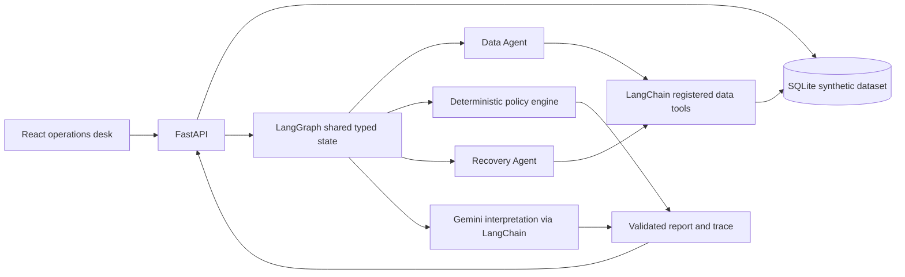

# Flyo Disruption Desk v2

A synthetic engineering demo for airline disruption investigation and recovery preparation. It does **not** connect to airline reservation systems, real-time flight feeds, or production passenger data. It never books, cancels, refunds, or rebooks.

## Architecture



LangGraph makes the sequence, shared state, conditional routing, and terminal outcome explicit. Registered LangChain tools are the only route to synthetic case and alternative records. Python policy code computes connection buffers and eligibility reasons; the model can explain those results but cannot alter them. Human review is persisted separately from analysis and never represents a booking action.

## Run locally

Requirements: Python 3.11+, Node.js 20+.

```bash
cd backend
python -m venv .venv
source .venv/bin/activate
pip install -r requirements.txt
cp .env.example .env
python -m app.seed
uvicorn app.main:app --reload
```

The database seeds exactly 50 synthetic cases, including the six core scenarios and the `INDEMO0025` regression. Re-running `python -m app.seed` is idempotent and preserves existing runs and human review history. For an intentional full local reset, stop the server, remove only `backend/flyo_disruption.db`, then seed again. The default SQLite path is relative to the backend working directory.

In a second terminal:

```bash
cd frontend
npm install
npm run dev
```

Open http://localhost:5173. Browse cases and deterministic policy without a Gemini key. To run AI explanation, place a key in `backend/.env` as `GEMINI_API_KEY=...`. The only supported model is `gemini-3.5-flash-lite`. No live call is made by tests. Provider/key errors are reported as failed runs, never replaced by fabricated completions.

## API

OpenAPI/Swagger: http://localhost:8000/docs

- `GET /health`
- `GET /api/cases`, `GET /api/cases/{case_id}`
- `GET /api/cases/{case_id}/itinerary`, `/alternatives`, `/policy`
- `POST /api/cases/{case_id}/analyze` or `/recovery`
- `GET /api/runs/{run_id}` and `/trace`
- `POST /api/reviews/{recommendation_id}/approve` or `/reject`

CORS defaults to localhost:5173. The API returns request IDs in `X-Request-ID`; logs include request ID and route metadata, but do not log keys.

## Development checks

```bash
cd backend
pytest
```

```bash
cd frontend
npm run typecheck
npm run lint
npm test
npm run build
```

## Scenarios and limitations

The 50 scenarios span cancellation, connection, weather, aircraft/crew/maintenance, airport constraints, diversion, evidence, transfer and manual-review conditions. The Recovery desk triage view classifies immediate connection/service risks, evidence checks, timed human reviews and monitored cases; the Case queue is the separate searchable workbench. Every case has a deterministic itinerary and zero or more seeded alternatives; tests run each case through the graph with mocked interpretation. The regression case `INDEMO0025` has DEMO-AI-2125, Air India label, BOM→COK (09:00–11:00 IST) then COK→GOI (11:30–13:30 IST) on 30 Oct 2026. Generic policy computes 30 minutes against a 60-minute minimum, escalates with `below_minimum_connection_buffer`, requires review, and has no seeded candidates. Other cases cover feasible candidate comparison, missing evidence, no eligible candidates, multi-leg options, and configured manual review.

All timestamps/candidate records are synthetic, not operationally validated. The demo's review endpoints are local workflow records. There is no authorization system, live flight inventory, booking integration, or production deployment configuration. Do not commit `.env` or database files.

## Troubleshooting

- **Missing key:** set `GEMINI_API_KEY` in `backend/.env`, then restart the backend. Dashboard and policy endpoints continue to work without it.
- **Provider or model error:** inspect the sanitized failed run and backend log. Confirm network access and that the configured model is exactly `gemini-3.5-flash-lite`; no secondary provider/model fallback exists.
- **Database appears empty:** run `python -m app.seed` from `backend/` and verify the configured relative SQLite path.
- **Frontend cannot connect:** run API on port 8000 and frontend on 5173; set `CORS_ORIGINS` if using a different frontend origin.
