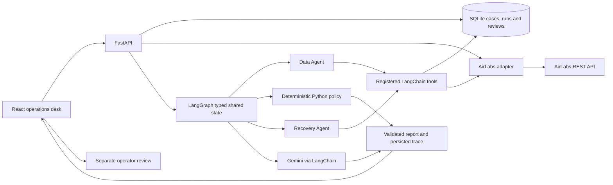

# Architecture notes

The application keeps simulated passenger/disruption records separate from provider-reported aviation facts:

- **Simulated case data:** passenger labels, itineraries, disruptions, and case history in local SQLite.
- **AirLabs flight facts:** flight identity, route, schedule and reported status from the server-side adapter. Reports identify `source=airlabs` and include a retrieval timestamp.

LangGraph owns workflow state, conditional routing, retries, and terminal outcomes. The Recovery Agent queries schedules only through the registered `search_airlabs_alternatives` LangChain tool. The adapter validates provider response fields and rejects records without flight number, route, or times. No app code calls a model provider SDK directly; Gemini integration remains in LangChain.

The deterministic policy is independent of prompts. It checks route and timing, marks cancelled records ineligible, requires operator review for live schedule recommendations, then deduplicates and ranks eligible provider results by earliest departure. Recovery reports retain at most three schedule slots and mark the first as the best timing match. Search remains a full provider-results view. Eligibility means only that a schedule passed those configured checks; it does not prove a seat, fare, or booking is available. Human approval remains a separate persisted review operation.

## AirLabs

The server sends `AIRLABS_API_KEY` in the documented `api_key` query parameter. Status uses `GET /api/v9/flight?flight_iata=...`; exact-date search uses `/api/v9/schedules` with IATA route filters. AirLabs documents that schedules return up to 10 hours ahead and the endpoint has no date filter, so the adapter filters rows to the requested date. When no exact-date row matches, Flyo queries `/api/v9/routes` and matches the requested weekday against the provider's recurring route database. These route patterns include published flight numbers and airport-local departure/arrival times, but are not live date-specific schedules and provide no flight status. A candidate that passes deterministic route/time checks remains an operator-verification suggestion, not a claim that the flight will operate or has seats. The account plan is unknown to the application and remains authoritative for access and quotas. See [AirLabs flight info](https://dev-gamma-fi.airlabs.co/docs/flight), [AirLabs schedules](https://www.airlabs.co/docs/schedules), and [AirLabs route database](https://dev-gamma-fi.airlabs.co/docs/routes).

The supplied key was accepted in a read-only flight lookup (HTTP 200); the returned AI101 record listed FCO → JFK and status `en-route` at lookup time. AirLabs documents that a single-flight lookup returns the closest matching scheduled/live/landed instance, so Flyo derives the record date from its departure timestamp and filters against the requested date. An API key does not prove which plan or quota is enabled; those remain provider-managed. Provider failures are never converted into training candidates or successful empty results.

Schedules are not inventory. Flight/customer cases remain simulated, and the system does not book, cancel, refund, or rebook.
